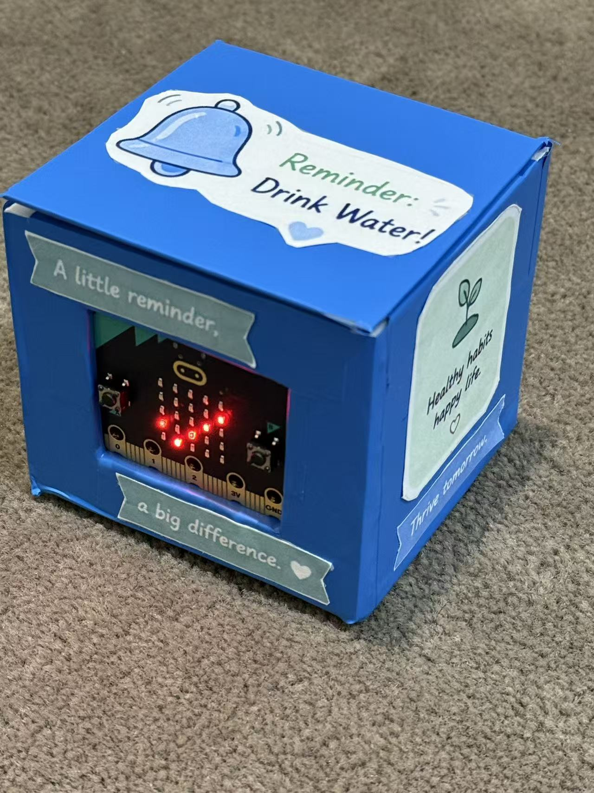
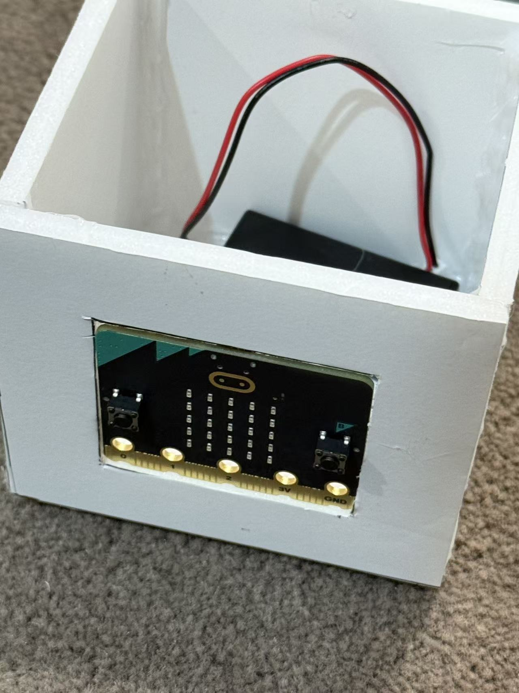
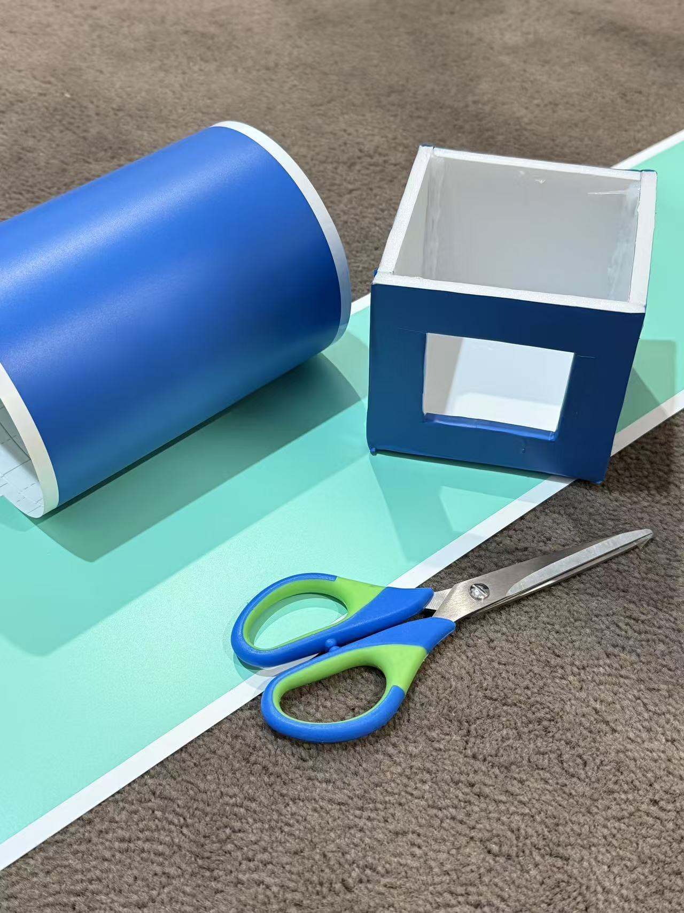

# Smart Water Reminder

A portable micro:bit V2 prototype that gives a gentle reminder to drink water and lets the user record drinks with a button. It combines short LED messages, simple animations, distinct sounds, and a handmade blue casing.

## What it does

- Plays a reminder sound and displays `SIP` after 30 minutes without a recorded drink. The reminder then starts another interval.
- Records a drink with button A and shows progress toward the configured target of eight.
- Uses different sounds for recording, reminders, reset, encouragement, and reaching the target.
- Provides physical controls for checking progress, resetting the counter, and receiving encouragement.

The photos document the original physical prototype. The source in [main.ts](main.ts) was recovered directly from the final JavaScript appendix of my own project report, with its original comments and logic preserved. The original MakeCode project export and a matching compiled `.hex` file were not found in the available archive.

## Hardware and materials

- BBC micro:bit V2, using its built-in LED matrix, speaker, buttons, touch logo, and accelerometer
- Compatible battery pack and batteries
- USB cable for programming
- Foam board for the enclosure, blue covering material, and decorative labels

The recovered code uses the micro:bit's built-in features; it does not require an external water sensor.

## Controls

| Input | Action |
| --- | --- |
| **A** | Record one drink, play a confirmation, and display the updated count. The count stops increasing at eight. |
| **B** | Show the current count, `OF`, the target, and an LED progress display. |
| **A + B** | Show `T` followed by the target. |
| **Touch logo** | Reset the count and reminder timer. |
| **Shake** | Play an encouragement sound and display a heart, `GO`, or `WIN`, depending on progress. |

At startup, the device plays a short sound, shows a heart, and displays `SIP`. Reaching the target produces a success sound and `DONE`.

## Open the source in MakeCode

This repository contains recovered source, rather than a complete exported MakeCode project. To create a project from it:

1. Open [MakeCode for micro:bit](https://makecode.microbit.org/) and create a new project.
2. Switch to the **JavaScript** editor.
3. Open [main.ts](main.ts), copy its complete contents, and replace the editor's starter code. MakeCode documents copy and paste into JavaScript view in its [FAQ](https://makecode.microbit.org/faq).
4. Review the code and try the controls in the simulator. The intended hardware is **micro:bit V2**, because the project uses its speaker and touch logo.
5. To try it on hardware, connect the micro:bit by USB and use **Download**. You can transfer the generated `.hex` to the `MICROBIT` drive, following the [official transfer instructions](https://makecode.microbit.org/device/usb).

The original interval is `1800000` milliseconds (30 minutes). The source comment suggests `10000` milliseconds for a short demonstration; the archived source retains the original value.

## Making the enclosure

The foam-board enclosure holds the board and battery pack while leaving the display and buttons accessible. Blue covering and labels give the physical prototype its water-reminder theme.

| Assembly | Casing work |
| --- | --- |
|  |  |

## Current status and limitations

- **Recovery checks:** the source matches the report appendix, and a static JavaScript syntax check passed. The source was not executed during recovery.
- **Not revalidated:** this recovered copy has not been compiled in MakeCode, run in its simulator, or tested again on a physical micro:bit. No new `.hex` is provided.
- A recorded “cup” is a button press. The prototype does not measure volume or detect drinking automatically.
- Eight is a configured prototype target, not a personalized hydration recommendation.
- The counter is kept in memory. It resets when the program restarts, and a new day requires a manual reset; there is no clock-based daily reset or saved history.
- The reminder loop continues after the target is reached. The recovered behavior is preserved here.
- The physical build is documented in the photos; there are no enclosure CAD files or measured fabrication drawings in this repository.

## 中文简介

这是一个 micro:bit V2 饮水提醒原型：每隔 30 分钟提醒，按 A 记录一次饮水，按 B 查看进度，A+B 查看目标，触摸标志复位，摇晃获得鼓励反馈。源码从自己的项目报告附录原样恢复，照片来自制作记录。此次仅完成源码一致性与静态语法检查，未重新编译、模拟运行或上板验证，也未找到对应的原始 `.hex` 文件。
